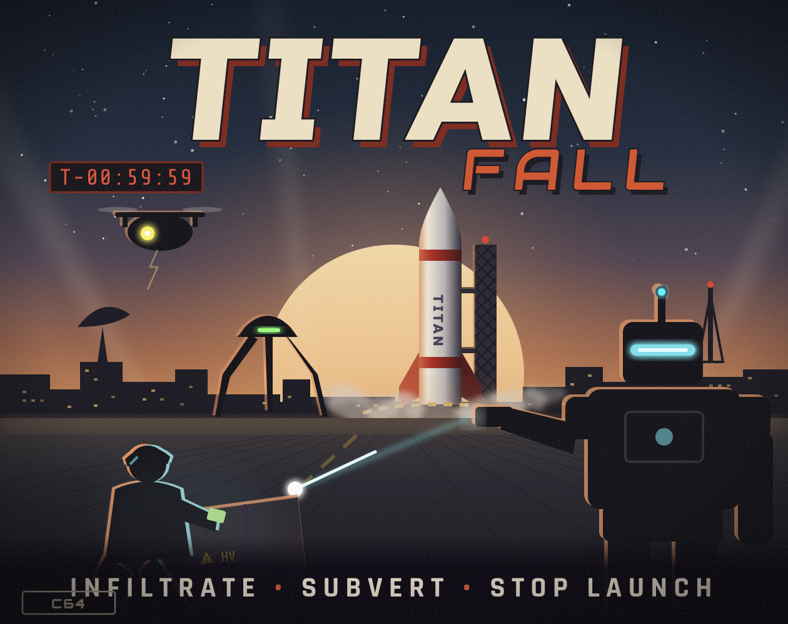
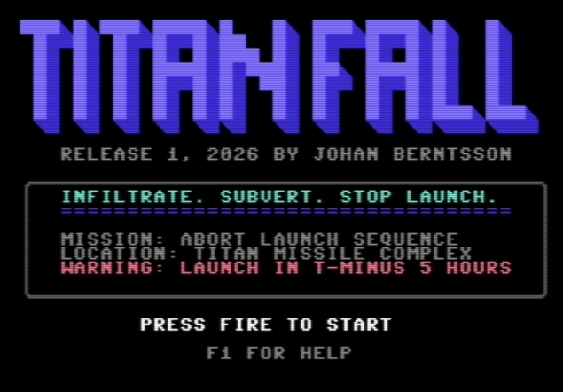
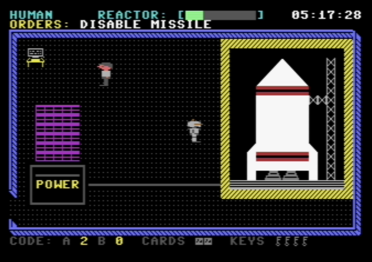
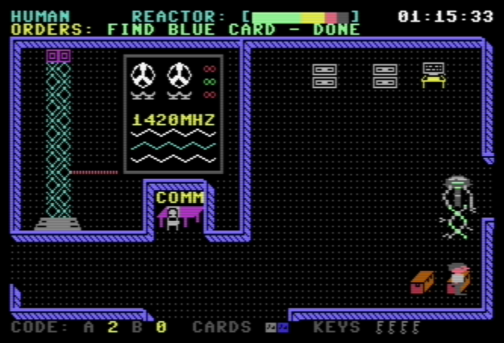
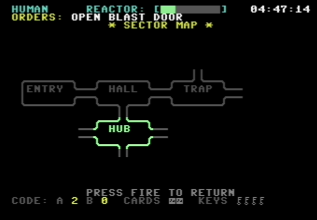
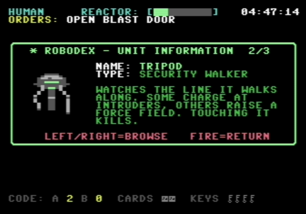
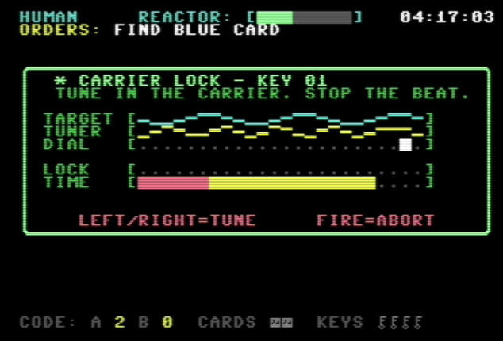

# TITAN Fall

*Infiltrate. Subvert. Stop launch.*



A cinematic infiltration puzzle game for the Commodore 64, in the spirit of
*Impossible Mission* and *Paradroid*. You have broken into TITAN, an
automated missile launch complex run by robots. The launch countdown is
already running. Take over the robots from the complex's own terminals and
use them to stop the launch before the clock reaches zero.

| | |
|---|---|
|  |  |
|  |  |
|  |  |

## Running it

Download [`release/titanfall.d64`](release/titanfall.d64). In VICE: `x64sc titanfall.d64`.
On a real C64 (PAL; the game is timed for 50 Hz):

```
LOAD "TITANFALL",8
RUN
```

## Controls

Joystick in port 2. The keyboard works the same way: WASD moves and Space is fire.

| Action | Joystick | Keyboard |
|---|---|---|
| Walk / drive a robot | stick | W A S D |
| Open a terminal (stand by a console) | fire | Space |
| Search (hold) | hold fire | hold Space |
| Shoot (while driving a robot that has a gun) | fire | Space |
| End a robot link early | — | F7 |
| Terminal menu: move / select / leave | up, down / fire | W, S / Space or Return / F7 |
| Carrier lock: tune / give up | left, right / fire | A, D / Space |
| Help and pause (from anywhere) | — | F1 |
| On the help screen: reset the room / restart the game | — | R / Run/Stop (Esc in VICE) |
| Where am I (room and position) | — | F2 (Shift+F1) |

## How to play

- **The clock.** The countdown in the top right is your real deadline. When it
  reaches zero, the mission has failed. The reactor gauge next to it heats up
  as time runs out.
- **Dying costs time.** Lasers, robots and their weapons kill on contact.
  Each death costs 30 minutes of countdown, and you start again where you
  entered the room. Anything you've found stays found, and any security codes you
  spent in the room where you died are given back (codes spent in earlier
  rooms stay spent).
- **Searching.** Stand on a piece of furniture or anything else in the room
  and hold fire to search it, Impossible Mission style (bare floor has
  nothing to search). It takes a moment, and the robots don't wait while you
  search.
- **Terminals.** The consoles let you view the sector map, read about the
  robots you've met (the *robodex*) and take over a robot in the same room.
  Taking one over costs a **security code** of the right type (shown on the
  bottom line, e.g. `CODE: A 2 B 0`). More codes are hidden around the
  complex. The link
  lasts **30 seconds** (a popup names the robot; the time starts when you
  close it): the countdown is shown in the top left, and then control snaps
  back to you. Press F7 to hand control back sooner.
- **Robots** each behave differently. Some patrol a fixed route and some
  wander the whole room. When they spot you, some charge, some shoot, and
  some advance behind a force field. They see along their own row, so keep
  that in mind.
- **Cards** open locked doors. Each card has a glyph on the bottom line
  (after `CARDS`) that lights up in the card's colour once you've found it;
  a card is used up when it opens its door.
- **Launch keys.** The silo door is sealed. Four launch keys are hidden in
  the complex (the glyphs after `KEYS` on the bottom line light up as you
  find them); turn them in at the launch interlock to open its cage and
  reach the console that releases the door.
- **Stuck? Reset the room.** A puzzle can end up unsolvable (a crate pushed
  into a corner, the robot you needed destroyed). Leaving a room before
  you've solved it puts it back the way it was. You can also press F1 and
  then R to reset it on the spot, but that costs 10 minutes of countdown,
  unless you have a **reset key**.
- **Reset keys** are won at the COMM desk in the hall: stand at it and press
  fire to play the carrier lock. The computer plays a tone, then yours joins in. Turn
  yours with left and right until the two waves on the screen line up and
  the beating between the tones stops (your wave turns green when you're
  close enough), then hold it there until the lock bar is full. The dial
  moves fast while you're far off and slows right down once you're close,
  so you can't overshoot. You can play as often as you like, but every key
  is harder to win than the last. The countdown keeps running while you play.

Hints, for when you're stuck:

<details>
<summary>Spoilers</summary>

1. The laser in the first room can't be crossed on foot, but a robot driven
   into it will burn it out (and itself with it).
2. Something red is hidden behind that laser.
3. One room holds a security code of a type you don't start with. A hopper
   has to jump for it.
4. The missile room's power stack is what keeps the launch alive, and the
   robot guarding it has a gun.

</details>

## Building from source

Needs Python 3 with PyYAML, [ACME](https://sourceforge.net/projects/acme-crossass/)
0.97, [Exomizer](https://bitbucket.org/magli143/exomizer) and
[VICE](https://vice-emu.sourceforge.io/) (`x64sc`, and `c1541` for the disk image).

```
make          # build titanfall.prg
make run      # build and start it in VICE
make release  # build release/titanfall.d64
make clean
```

The world (rooms, robots, items, doors, lasers, security codes, the clock)
is defined in `titan.yaml`, and the room art is drawn in
[vchar64](https://github.com/ricardoquesada/vchar64) (`graphics/`). The
build turns both into assembly data, so most content changes don't need any
code. `CLAUDE.md` describes the code and its design in detail.
